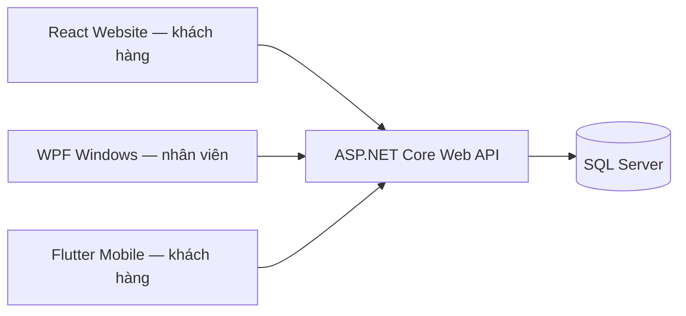

# Kiến trúc tối thiểu

Ba client dùng chung API và quy tắc nghiệp vụ. Windows không truy cập SQL trực tiếp. Backend một ứng dụng, chia module theo nghiệp vụ; chưa cần microservices, message broker hay Kubernetes.

Domain chứa thực thể và quy tắc không phụ thuộc EF/HTTP. Infrastructure chứa DbContext/migrations SQL. Contracts chứa DTO; Api điều phối HTTP, cấu hình, xác thực/phân quyền tương lai. Không thêm lớp trung gian nếu chưa có nhu cầu.

UI React/WPF kế thừa giao diện đã làm, đang dùng dữ liệu cục bộ. Mỗi client có điểm thử kết nối `/health`; mobile có màn danh mục đọc API. Khi đưa module vào dùng thật, thay state/mock bằng API rồi ghi trạng thái vào docs/status.md, thêm test quyền và kiểm tra nghiệp vụ.

Web/mobile hướng khách hàng: tra cứu, đăng ký, thanh toán, lịch/hồ sơ. Windows hướng nhân viên: tiếp nhận, khám/chỉ định, thu ngân, tiêm/theo dõi, kho, danh mục, báo cáo và tài khoản. Việc cùng có chức năng trên nhiều client không tạo ba bộ xử lý nghiệp vụ riêng.

Phát triển dùng HTTP localhost; triển khai cần HTTPS. Android emulator truy cập máy host bằng 10.0.2.2. iOS cần macOS/Xcode để build; repo có khung iOS nhưng không bảo đảm build iOS trên Windows.
